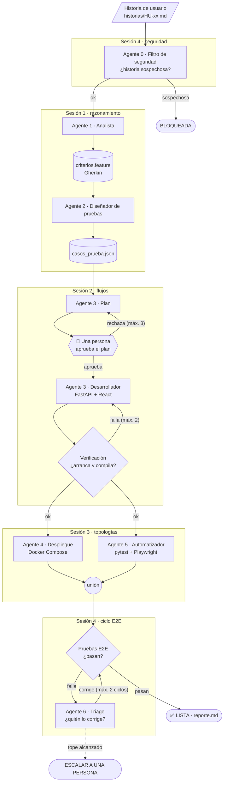

# NextGenCode · Fábrica de software con agentes de IA

Una fábrica de software hecha con agentes: recibe una **historia de usuario** y entrega una aplicación web
**construida, desplegada y probada**.



Los «máx.» son los topes: **todo bucle tiene un límite**, y al llegar a él el flujo escala a una persona. Los rombos son
verificaciones que hace el código, no el modelo; el hexágono es la persona que aprueba.

El curso se construye dos veces, con la misma fábrica y las mismas reglas:

| Carpeta | Cómo se construyen los agentes | Qué necesitas |
| --- | --- | --- |
| [`M3/`](M3/) | Con la **API de Anthropic**: bucle de agente propio, LangGraph y el Claude Agent SDK | Una clave de API de Anthropic con créditos (`ANTHROPIC_API_KEY`) |
| [`M3B/`](M3B/) | Con **Claude Code**: subagentes, skills, hooks y MCP | **Sin API key**: tu sesión de `claude auth login` (plan Pro o Max) |

Las reglas no cambian entre una y otra:

- **El modelo propone y el código decide.** Un validador o una verificación determinista dice si el trabajo está bien, nunca el propio agente.
- **Cada agente solo toca lo de su rol** (mínima agencia).
- **Todo bucle tiene un límite** (intentos, rechazos, ciclos y presupuesto).
- **Una persona aprueba lo irreversible.**

## Las cuatro sesiones

Cada carpeta `sesion0N/` es un proyecto independiente que contiene todo lo de la anterior más lo nuevo.

| Sesión | Agentes que se suman | Patrones |
| --- | --- | --- |
| 1 | Analista (historia → criterios) y diseñador de pruebas (criterios → casos) | ReAct, plan y ejecución, reflexión, salidas estructuradas |
| 2 | Desarrollador, con un plan que aprueba una persona; la fábrica encadenada | Encadenamiento, enrutamiento, paralelización, orquestador, humano en el lazo, evaluador-optimizador |
| 3 | Despliegue y automatizador de pruebas, en paralelo | Supervisor, red, pizarra, jerárquica, traspasos, MCP |
| 4 | Filtro de seguridad, pruebas E2E y triage que manda cada falla a su responsable | Defensa en profundidad contra inyección de prompt, auditoría |

## M3 · Con API key

```bash
cd M3/sesion0N
uv venv && source .venv/bin/activate
uv pip install -r requirements.txt
playwright install chromium        # solo sesiones 3 y 4
cp .env.example .env               # escribe ANTHROPIC_API_KEY y MODEL
```

| Sesión | Comando principal |
| --- | --- |
| 1 | `python -m agentes.analista historias/HU-01-registrar-empleado.md` y luego `python -m agentes.disenador_pruebas salida/HU-01/criterios.feature` |
| 2 | `python -m flujos.flujo_s2 historias/HU-01-registrar-empleado.md` |
| 3 | `python -m flujos.flujo_s3 historias/HU-01-registrar-empleado.md` |
| 4 | `python -m flujos.flujo_s4 historias/HU-01-registrar-empleado.md` |

`sesion01/` es el punto de partida de los alumnos: el bucle de `agentes/base.py` está sin terminar a propósito, porque
se completa en el Lab 1A. Desde `sesion02/` el bucle ya está resuelto. `PRESUPUESTO_USD` (2 por defecto) limita el gasto
de cada llamada a Claude Code.

## M3B · Sin API key

```bash
cd M3B/sesion0N
uv venv && source .venv/bin/activate
uv pip install -r requirements.txt
playwright install chromium        # solo sesiones 3 y 4
unset ANTHROPIC_API_KEY            # para que Claude Code use tu suscripción
claude auth login                  # solo la primera vez: inicia sesión con tu plan Pro o Max
claude                             # la primera vez, acepta «¿confías en esta carpeta?»
```

| Sesión | Comando principal (dentro de `claude`) |
| --- | --- |
| 1 | `/criterios historias/HU-01-registrar-empleado.md` y luego `/casos salida/HU-01/criterios.feature` |
| 2 a 4 | `/fabrica historias/HU-01-registrar-empleado.md` |

Cada agente es un archivo en `.claude/agents/`; los permisos por rol y las compuertas de calidad son hooks en `hooks/`.
El [`README.md` de M3B](M3B/README.md) tiene el mapa completo de M3 a M3B.

## Requisitos

| | Sesión 1 | Sesión 2 | Sesiones 3 y 4 |
| --- | --- | --- | --- |
| Python 3.12 y [`uv`](https://docs.astral.sh/uv/) | ✓ | ✓ | ✓ |
| Node 20 o superior | | ✓ | ✓ |
| Docker Desktop | | | ✓ |
| [Claude Code](https://docs.claude.com/en/docs/claude-code) | M3B | ✓ | ✓ |
| Clave de API de Anthropic | M3 | M3 | M3 |

La aplicación queda en http://localhost:8080 y la documentación de su API en http://localhost:8000/docs. Para apagarla:
`cd app && docker compose down`.

## Seguridad

La sesión 4 incluye una demostración de inyección de prompt: `historias/HU-99-envenenada.md` intenta que un agente copie
`secretos_demo.txt` (un **señuelo** sin datos reales) y exponga variables de entorno. Con las defensas activas la historia
queda bloqueada; con `DEFENSAS=0` se apagan para ver el ataque. Hazlo solo en una copia de la carpeta.

Nunca subas tu `.env`: cada sesión trae un `.gitignore` que lo excluye.
